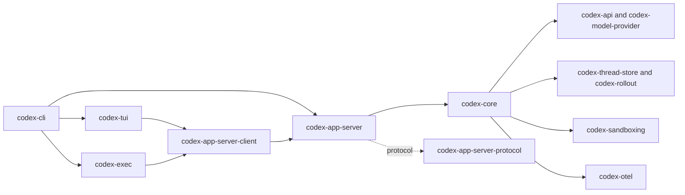
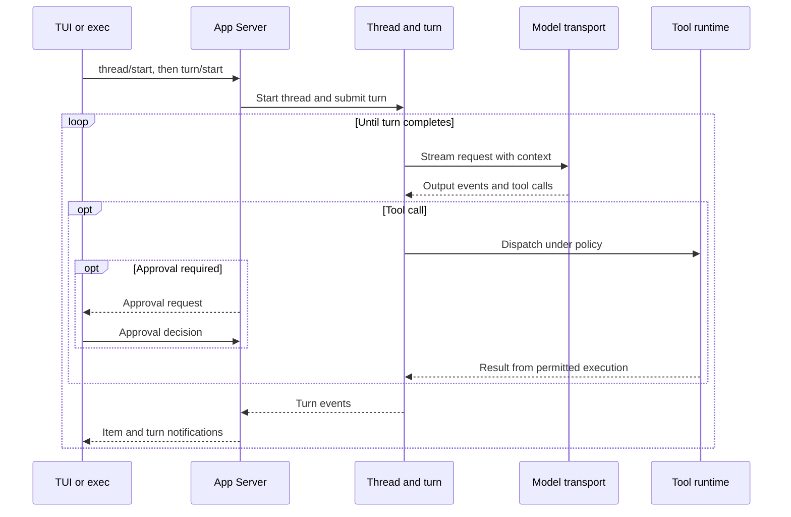

# Sendan Codex baseline

AICLI-115 through AICLI-118 use [Codex 0.171.0](https://github.com/openai/codex/releases/tag/rust-v0.171.0), commit `ccf9be8cc458bd6b8336fe84d68d8893f2691a5e`. The existing Sendan integration already targets this version. The first validation target is Linux x86-64 GNU on Ubuntu 24.04. The upstream release matrix also builds Linux musl, macOS, and Windows packages.

The source test matrix uses the official release parent `9e59e679c183ea69bc71cf90b8fe84e5bc83bc51`. CI verifies that the release commit changes only the workspace version from `0.0.0` to `0.171.0`. This keeps the upstream TUI snapshots on their expected development version while the built archive and its smoke tests use the exact release tag. [Upstream release commit](https://github.com/openai/codex/commit/ccf9be8cc458bd6b8336fe84d68d8893f2691a5e)

Upstream publishes tagged artifacts through its [release workflow](https://github.com/openai/codex/blob/ccf9be8cc458bd6b8336fe84d68d8893f2691a5e/.github/workflows/rust-release.yml). Its [security policy](https://github.com/openai/codex/blob/ccf9be8cc458bd6b8336fe84d68d8893f2691a5e/SECURITY.md) describes the upstream advisory and incident reporting process.

## Build and test

Use [Sendan Codex baseline](../../.github/workflows/sendan-codex-baseline.yml) for the exact runner, toolchain, native dependencies, and checked V8 inputs. It checks out the upstream commit directly. Cargo refreshes the published lockfile in the build checkout, as in upstream release CI, and the workflow records its diff and checksum. Run the same commands in a clean checkout with Rust `1.99.1`, the workflow's native dependencies, and its verified `RUSTY_V8_ARCHIVE` and `RUSTY_V8_SRC_BINDING_PATH`.

```sh
git clone --origin upstream --branch rust-v0.171.0 --depth 1 https://github.com/openai/codex.git
cd codex
test "$(git rev-parse HEAD)" = ccf9be8cc458bd6b8336fe84d68d8893f2691a5e
test -z "$(git status --porcelain)"
cd codex-rs
export STABLE_GIT_COMMIT="$(git rev-parse HEAD)"
export CARGO_INCREMENTAL=0 CARGO_PROFILE_DEV_DEBUG=0 CARGO_PROFILE_TEST_DEBUG=0
cargo build --bin bwrap
export CODEX_BWRAP_SHA256="$(sha256sum target/debug/bwrap | cut -d' ' -f1)"
cargo build --locked -p codex-cli --bin codex
target/debug/codex --version
target/debug/codex exec --help
target/debug/codex app-server --help
```

Run the source tests in a separate checkout to preserve the built release.

```sh
git clone --origin upstream --branch rust-v0.171.0 --depth 2 https://github.com/openai/codex.git codex-test
cd codex-test
git switch --detach 9e59e679c183ea69bc71cf90b8fe84e5bc83bc51
cd codex-rs
export STABLE_GIT_COMMIT="$(git rev-parse HEAD)"
export CARGO_INCREMENTAL=0 CARGO_PROFILE_DEV_DEBUG=0 CARGO_PROFILE_TEST_DEBUG=0
cargo build --bin bwrap
install -D target/debug/bwrap target/debug/codex-resources/bwrap
export CODEX_BWRAP_SHA256="$(sha256sum target/debug/bwrap | cut -d' ' -f1)"
cargo build --locked --bin codex --bin codex-code-mode-host --bin codex-exec-server \
  --bin codex-linux-sandbox --bin test_stdio_server --bin codex-message-board-mcp
RUST_MIN_STACK=8388608 NEXTEST_PROFILE=local cargo nextest run --locked --no-fail-fast \
  -p codex-core -p codex-exec -p codex-app-server -p codex-app-server-protocol \
  -p codex-tui -p codex-config -p codex-execpolicy -p codex-linux-sandbox
```

The exec suite exercises a real CLI process with an upstream loopback Responses API fixture. `exec_appends_piped_stdin_to_prompt_argument` passed on the release tag and verified the request body in a credential-free run. The [release-tag test logs](https://github.com/HAstaShakiba/Sendan-Codex/actions/runs/45024817878) also record 715 passing policy tests. That test run exposed the release-version snapshot differences and missing integration helpers that motivated the test matrix above.

The baseline workflow uses upstream's package builder with the CLI, code-mode host, executor, and bubblewrap built from the same SHA. It stages the supplied notices and provenance metadata in the validation archive and launches the packaged CLI. The [Linux build and archive smoke checks](https://github.com/HAstaShakiba/Sendan-Codex/actions/runs/45022654933) passed. Download the [package manifest and archive checksum](https://github.com/HAstaShakiba/Sendan-Codex/actions/runs/45022654933/artifacts/14755161112). The binary archive is a CI validation output pending the redistribution review below.

### Source suite results

| Suite | Passed | Failed | Skipped | Notes |
| --- | ---: | ---: | ---: | --- |
| Core | 6,262 | 0 | 9 | Three tests passed on retry |
| Config, execpolicy, and Linux sandbox | 715 | 0 | 3 | |
| App Server and Protocol | 2,598 | 0 | 3 | Retried the job after an HTTP 403 during V8 download |
| Exec and TUI, config, execpolicy, and Linux sandbox | 7,196 | 0 | 11 | All client and policy tests passed after the narrow Linux sandbox fix |

The [baseline validation run](https://github.com/HAstaShakiba/Sendan-Codex/actions/runs/45175908110) passed both new `codex-linux-sandbox` regressions, the formerly failing `nested_apply_patch_alias_works_with_restricted_reads` integration test, and all 7,196 client and policy tests (11 skipped). The workflow also verified that the upstream source checkout was clean after restoring its release manifest and lockfile.

The failure was caused by a rootless deny mask hiding an explicitly readable descendant beneath a denied parent. The fix omits that redundant mask only when the restricted empty-root filesystem has no readable ancestor exposing the denied parent; regression coverage keeps the mask when a broader readable root exists. Build caching is configured with sccache in the workflow, but this dispatched run did not include the cache steps, so cache hits and speedup are not yet verified.

## Source map

All source links point to the pinned commit. The [workspace manifest](https://github.com/openai/codex/blob/ccf9be8cc458bd6b8336fe84d68d8893f2691a5e/codex-rs/Cargo.toml) lists crate membership and dependency edges.

| Area | Source and behavior |
| --- | --- |
| CLI startup | [`cli/src/main.rs`](https://github.com/openai/codex/blob/ccf9be8cc458bd6b8336fe84d68d8893f2691a5e/codex-rs/cli/src/main.rs#L1046) initializes build info and dispatches arg0 helpers, subcommands, and the TUI. [`exec/src/lib.rs`](https://github.com/openai/codex/blob/ccf9be8cc458bd6b8336fe84d68d8893f2691a5e/codex-rs/exec/src/lib.rs#L929) uses the App Server client for non-interactive execution. |
| App Server and TUI | [`app-server/src/lib.rs`](https://github.com/openai/codex/blob/ccf9be8cc458bd6b8336fe84d68d8893f2691a5e/codex-rs/app-server/src/lib.rs#L452) starts the server. [`message_processor.rs`](https://github.com/openai/codex/blob/ccf9be8cc458bd6b8336fe84d68d8893f2691a5e/codex-rs/app-server/src/message_processor.rs#L1422) dispatches typed requests. [`tui/src/app_server_connection.rs`](https://github.com/openai/codex/blob/ccf9be8cc458bd6b8336fe84d68d8893f2691a5e/codex-rs/tui/src/app_server_connection.rs) connects the interactive client. |
| Agent loop and context | [`core/src/thread_manager.rs`](https://github.com/openai/codex/blob/ccf9be8cc458bd6b8336fe84d68d8893f2691a5e/codex-rs/core/src/thread_manager.rs#L1404) starts threads. [`core/src/session/turn.rs`](https://github.com/openai/codex/blob/ccf9be8cc458bd6b8336fe84d68d8893f2691a5e/codex-rs/core/src/session/turn.rs#L215) runs turns, including prompt assembly, sampling, and tool-output handling. |
| Model and streaming | [`core/src/client.rs`](https://github.com/openai/codex/blob/ccf9be8cc458bd6b8336fe84d68d8893f2691a5e/codex-rs/core/src/client.rs#L1189) constructs Responses requests and handles transport decisions. The [SSE decoder](https://github.com/openai/codex/blob/ccf9be8cc458bd6b8336fe84d68d8893f2691a5e/codex-rs/codex-api/src/sse/responses.rs) parses streamed events. |
| Tools, approval and sandbox | [`router.rs`](https://github.com/openai/codex/blob/ccf9be8cc458bd6b8336fe84d68d8893f2691a5e/codex-rs/core/src/tools/router.rs#L351) dispatches calls. [`orchestrator.rs`](https://github.com/openai/codex/blob/ccf9be8cc458bd6b8336fe84d68d8893f2691a5e/codex-rs/core/src/tools/orchestrator.rs#L126) coordinates approval and attempts. [`sandboxing/src/manager.rs`](https://github.com/openai/codex/blob/ccf9be8cc458bd6b8336fe84d68d8893f2691a5e/codex-rs/sandboxing/src/manager.rs#L436) transforms execution requests into platform sandbox invocations. |
| Session persistence | [`thread-store/src/local/mod.rs`](https://github.com/openai/codex/blob/ccf9be8cc458bd6b8336fe84d68d8893f2691a5e/codex-rs/thread-store/src/local/mod.rs) provides local thread storage. [`rollout/src/recorder.rs`](https://github.com/openai/codex/blob/ccf9be8cc458bd6b8336fe84d68d8893f2691a5e/codex-rs/rollout/src/recorder.rs) writes and loads rollout records. |
| Config and telemetry | The [config loader](https://github.com/openai/codex/blob/ccf9be8cc458bd6b8336fe84d68d8893f2691a5e/codex-rs/config/src/loader/mod.rs) composes config layers and requirements. The [OTel provider](https://github.com/openai/codex/blob/ccf9be8cc458bd6b8336fe84d68d8893f2691a5e/codex-rs/otel/src/provider.rs) configures telemetry providers and exporters. |





Start the later provider work in `codex-model-provider`, the core request setup, and `codex-api` only where provider capabilities or wire formats differ. Attach application ownership and workspace references at App Server request handlers. Carry policy through the existing tool orchestrator, execpolicy and platform sandbox. Keep the current telemetry configuration and secret redaction paths in scope when adding usage events.

## Upstream sync and rollback

- Use `origin` for `HAstaShakiba/Sendan-Codex` and `upstream` for `openai/codex`. Keep `sendan/develop` as the protected integration branch. Start product changes from it in short-lived branches and put the AICLI issue key in the PR and commit message.
- Review upstream once per week and on security advisories. Fetch `upstream/main` and the candidate release tag. Unshallow the local baseline clone before comparing or merging earlier history. Resolve the peeled tag to a commit and record both in the pin update.
- Open a PR from a sync branch. Validate the candidate SHA using the upstream suites, smoke test, dependency inventory and notice review. Integrate upstream history and any compatibility fixes as separately identifiable commits. Confirm the current patch stack also builds before changing the release pointer.
- Use a revert PR for regressions on `sendan/develop`. Roll deployment back to the last validated artifact and its pin, checksum and patch version. Avoid force pushes to the protected branch.

## Redistribution evidence

The [Apache-2.0 LICENSE](https://github.com/openai/codex/blob/ccf9be8cc458bd6b8336fe84d68d8893f2691a5e/LICENSE) and [NOTICE](https://github.com/openai/codex/blob/ccf9be8cc458bd6b8336fe84d68d8893f2691a5e/NOTICE) cover the upstream source and include Ratatui attribution. Preserve these files with the package. Review the vendored bubblewrap LGPL terms in `codex-rs/vendor/bubblewrap/{COPYING,LICENSE}`, V8 and embedded native dependencies, resource and skill licenses, and any bundled ripgrep or voice components against the actual artifact contents. Record the upstream source and part-specific notices, plus the mechanism for any applicable source or relinking obligations.

Download the Cargo CycloneDX SBOMs and declared-license TSV from [Sendan Codex dependency inventory](../../.github/workflows/sendan-codex-inventory.yml). Compare the Rust graph with the built binaries and native/resource inventory, and review missing or conflicting declarations. The workflow also runs the upstream [cargo-deny policy](https://github.com/openai/codex/blob/ccf9be8cc458bd6b8336fe84d68d8893f2691a5e/codex-rs/deny.toml). Unresolved license or security findings block release. Upstream trademark and provider entitlement review are separate release requirements. Keep original CLI executable names and strings in this baseline. Record SHA, patch version, target and checksums in distribution metadata.

The [inventory artifact](https://github.com/HAstaShakiba/Sendan-Codex/actions/runs/45022503496/artifacts/14753833685) includes four Rust SBOMs and 1,325 Cargo license entries. The [audit run](https://github.com/HAstaShakiba/Sendan-Codex/actions/runs/45022503496) passed the licenses, bans, and sources checks. Its advisory check reported `RUSTSEC-2026-0592` in `url 2.5.8` with a fix at `2.5.9` or later. Keep this pinned dependency set for baseline comparisons and require a clean audit on the release candidate.

The bundled ripgrep 15.2.0 archive matched the upstream DotSlash SHA-256 and contains `UNLICENSE`, `LICENSE-MIT`, and `COPYING`. Collect those exact notices for redistribution. The dependency inventory includes the matching ripgrep and V8 release manifests. The native redistribution review remains open for the V8 binary and its linked components.
